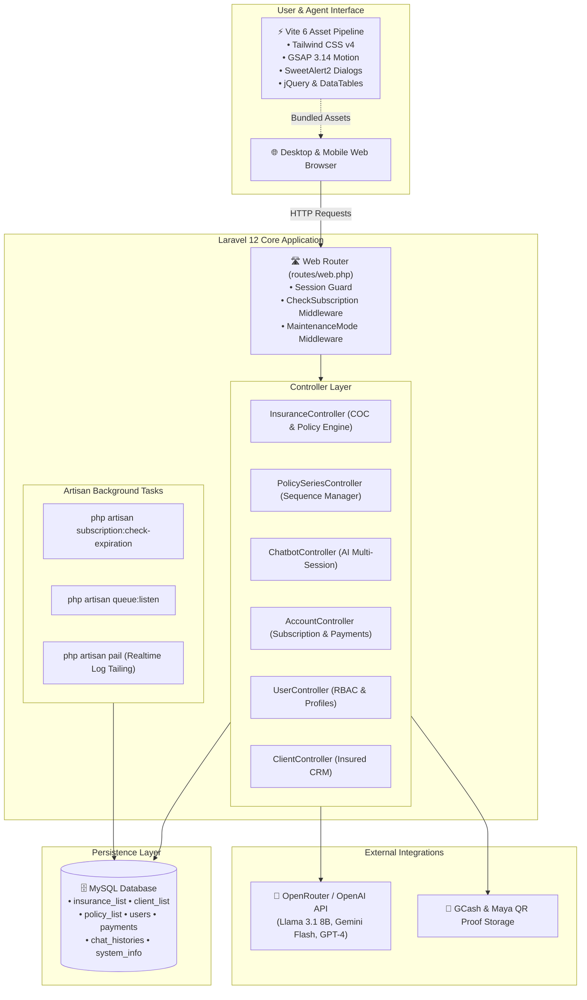

# 🚗 ECTPL-VIMSYS (Version 5 — SaaS Edition)

> **Compulsory Third Party Liability Vehicle Insurance Management System — Modern Laravel 12 Rebuild & Multi-Tenant SaaS Platform.**

[](https://laravel.com/)
[](https://www.php.net/)
[](https://tailwindcss.com/)
[](https://vitejs.dev/)
[](https://gsap.com/)
[](https://openrouter.ai/)
[](https://yajrabox.com/)
[](LICENSE)

---

## 📌 Table of Contents

- [Overview & Migration Mission](#-overview--migration-mission)
- [System Architecture](#-system-architecture)
- [Repository Directory Structure](#-repository-directory-structure)
- [UI/UX Design System & Aesthetics](#-uiux-design-system--aesthetics)
- [Core Modules & Features](#-core-modules--features)
  - [1. CTPL Vehicle Insurance Management](#1-ctpl-vehicle-insurance-management)
  - [2. Policy Series & Allocation Control](#2-policy-series--allocation-control)
  - [3. SaaS Multi-Tenant Subscription Engine](#3-saas-multi-tenant-subscription-engine)
  - [4. "VIMSY" Intelligent AI Chatbot](#4-vimsy-intelligent-ai-chatbot)
  - [5. Branch Office & User Management](#5-branch-office--user-management)
  - [6. Dynamic Maintenance System](#6-dynamic-maintenance-system)
- [Step-by-Step Setup & Execution Guide](#-step-by-step-setup--execution-guide)
  - [Prerequisites](#prerequisites)
  - [Step 1: Environment Configuration](#step-1-environment-configuration)
  - [Step 2: Install PHP & Node Dependencies](#step-2-install-php--node-dependencies)
  - [Step 3: Database Migration & Schema](#step-3-database-migration--schema)
  - [Step 4: AI Chatbot Configuration](#step-4-ai-chatbot-configuration)
  - [Step 5: Run the Development Server](#step-5-run-the-development-server)
  - [Step 6: Subscription Expiration Testing](#step-6-subscription-expiration-testing)
- [Default Roles & Access Control](#-default-roles--access-control)
- [Railway & Production Deployment](#-railway--production-deployment)
- [Contact & Organization](#-contact--organization)

---

## 📖 Overview & Migration Mission

**ECTPL-VIMSYS Version 5** is the comprehensive, cloud-native **Laravel 12 rebuild** of the operational legacy vehicle insurance platform running in **Northern Mindanao (Region 10), Philippines**.

The legacy production system (Version 4) is currently live and operational:
- **Production Site**: [https://ectpl-vimsys.com](https://ectpl-vimsys.com) (Version 4)
- **Staging Site**: [https://ectpl-vimsys.rf.gd](https://ectpl-vimsys.rf.gd) (Version 4)
- **Status**: Live and processing Compulsory Third Party Liability (CTPL) policies across regional branch offices.

### Version 5 Objectives
1. **Framework Modernization**: Transition from procedural legacy PHP to **Laravel 12 MVC** architecture with robust Eloquent ORM relationships.
2. **Multi-Tenant SaaS Capabilities**: Introduce automated monthly/yearly subscriptions with grace periods, QR-code payment verification (GCash & Maya), and automated account status control.
3. **Automated Auditing & Validation**: Real-time validation preventing duplicate **Certificate of Cover (COC)** numbers and **Motor Vehicle File (MV File)** numbers.
4. **Embedded AI Assistant ("VIMSY")**: Context-aware AI copilot integrated via OpenRouter/OpenAI to guide agents through complex policy generation and walk-in workflows.
5. **Modern Interface & Dynamic UX**: Built using Tailwind CSS v4, GSAP 3.14 smooth transitions, SweetAlert2 modal dialogs, and Yajra server-side DataTables.

---

## 🏛 System Architecture



---

## 📂 Repository Directory Structure

```text
vims-v5.0.0-Laravel/
├── README.md                          # Master documentation (this file)
├── SUBSCRIPTION_README.md             # Detailed documentation for subscription engine
├── composer.json                      # PHP dependencies (Laravel 12, Yajra, OpenAI)
├── package.json                       # Node dependencies (Tailwind v4, GSAP, Vite 6)
├── artisan                            # Laravel CLI binary
├── vite.config.js                     # Vite build configuration with Tailwind plugin
├── railway.json & railway.toml        # Production cloud deployment descriptors
│
├── app/
│   ├── Console/Commands/              # Custom Artisan commands
│   │   └── CheckSubscriptionExpiration.php  # Automated subscription expiration auditor
│   ├── Http/
│   │   ├── Controllers/               # Core business controllers
│   │   │   ├── InsuranceController.php       # COC validation, policy lifecycle, MV file
│   │   │   ├── PolicySeriesController.php    # Serial number distribution & security
│   │   │   ├── ChatbotController.php         # Multi-session AI assistant (OpenRouter/OpenAI)
│   │   │   ├── AccountController.php         # Subscriptions, QR proofs, payment approval
│   │   │   ├── UserController.php            # Multi-tier user accounts & permissions
│   │   │   ├── ClientController.php          # Insured vehicle owners CRM
│   │   │   ├── WalkinController.php          # Walk-in customer intake & conversion
│   │   │   ├── OfficeController.php          # Branch office management
│   │   │   ├── CategoryController.php        # Insurance vehicle classifications
│   │   │   ├── SettingsController.php        # Brand customization & maintenance toggle
│   │   │   └── DashboardController.php       # Analytical metrics & expiration alerts
│   │   └── Middleware/
│   │       ├── CheckSubscription.php         # Enforces active subscription status
│   │       └── MaintenanceModeMiddleware.php # Custom zero-downtime maintenance bypass
│   └── Models/                        # Eloquent ORM domain models
│       ├── Insurance.php              # Table: insurance_list
│       ├── Client.php                 # Table: client_list
│       ├── Policy.php                 # Table: policy_list
│       ├── Series.php                 # Serial number ranges
│       ├── Payment.php                # Subscription payment records & proof images
│       ├── ChatHistory.php            # AI conversation sessions & context memory
│       ├── User.php                   # User accounts, subscriptions, & branch links
│       ├── Office.php                 # Branch office locations (Region 10)
│       ├── MaintenanceMode.php        # System maintenance state
│       └── SystemInfo.php             # Dynamic platform branding metadata
│
├── config/
│   ├── chatbot.php                    # AI model list (Llama 3.1, Gemini), prompts, limits
│   ├── database.php                   # MySQL / MariaDB / SQLite connection drivers
│   └── app.php                        # Service providers and application settings
│
├── database/
│   ├── migrations/                    # Database migration schema definitions
│   └── seeders/                       # Seeders for testing & baseline configuration
│
├── resources/
│   ├── css/app.css                    # Tailwind CSS v4 entrypoint
│   ├── js/app.js                      # Frontend scripts, GSAP initializers, Axios
│   └── views/                         # Blade UI templates
│       ├── layouts/                   # Master app shell, sidebar navigation, top header
│       ├── auth/login.blade.php       # Authentication portal with dynamic brand cover
│       ├── chatbot/index.blade.php    # Interactive "VIMSY" AI assistant chat window
│       ├── insurances/                # COC form, insurance data table, print previews
│       ├── clients/                   # Client management modals & history
│       ├── policies/                  # Policy catalog & series distribution
│       ├── walkin/                    # Walk-in logs
│       ├── account/                   # Account settings, QR code payment modal, history
│       └── settings/                  # Brand configuration & maintenance switcher
│
└── routes/
    ├── web.php                        # Authenticated, subscription-guarded, & admin routes
    └── console.php                    # Scheduled artisan command definitions
```

---

## 🎨 UI/UX Design System & Aesthetics

ECTPL-VIMSYS Version 5 incorporates a modern, high-contrast, responsive visual interface tailored for insurance agents and administrative supervisors:

### 1. Color Palette

| Token / Role | Hex Code | Visual Swatch | Purpose |
|---|---|---|---|
| **Primary Brand** | `#0284C7` / `#0369A1` | `rgb(2, 132, 199)` 🟦 | Primary buttons, active navigation, COC highlights |
| **Success / Validated** | `#10B981` / `#059669` | `rgb(16, 185, 129)` 🟩 | Active policies, approved payments, valid COC numbers |
| **Warning / Grace** | `#F59E0B` / `#D97706` | `rgb(245, 158, 11)` 🟧 | 30-day subscription grace period, near-expiry alert |
| **Error / Expired** | `#EF4444` / `#DC2626` | `rgb(239, 68, 68)` 🔴 | Expired subscriptions, duplicate COC collision, rejected |
| **Canvas Background** | `#F8FAFC` | `rgb(248, 250, 252)` ⬜ | Ultra-clean slate dashboard background |
| **Card Surface** | `#FFFFFF` | `rgb(255, 255, 255)` ⬜ | Elevated card containers with subtle border radiuses |
| **Heading & Text** | `#0F172A` | `rgb(15, 23, 42)` ⬛ | Crisp readability on high-density information displays |

### 2. Motion & Interaction (GSAP 3.14)
- **Staggered Card Intros**: Metric summary cards fade and slide in smoothly on page load.
- **Dynamic Feedback**: Interactive SweetAlert2 toasts for one-click operations (approving subscription payments, validating COC numbers).
- **Yajra DataTables**: Instant client-side search, multi-column sorting, and server-side pagination across tens of thousands of policy records.

---

## ⚙️ Core Modules & Features

### 1. CTPL Vehicle Insurance Management
- **Full Vehicle Lifecycle**: Track vehicle plate number, chassis number, engine number, make, vehicle model, color, registration date, and official expiration.
- **Live Collision Validation**: Standalone AJAX endpoints (`/insurance/validate-coc` and `/insurance/validate-mvfile`) ensure no two policies can share the same COC or MV File number.
- **Digital Document Archival**: Store digital policy documents and receipts directly in local/cloud storage.

### 2. Policy Series & Allocation Control
- Prevents serial overlap between regional branches (e.g. Cagayan de Oro vs Gingoog Office).
- Allocates specific starting and ending series ranges without prefix corruption.
- Real-time statistics showing consumed vs. remaining numbers in each active booklet.

### 3. SaaS Multi-Tenant Subscription Engine
- **Plans**: Monthly, Yearly, and Free Trial.
- **Grace Period**: 30-day grace period post-expiration before hard suspension (`status = 0`).
- **Payment Gateway Flow**:
  1. Users view company GCash / Maya QR codes under **Account Settings**.
  2. Users upload their transaction reference number and proof-of-payment screenshot.
  3. Super-Admin (`id=1`, `office_id=0`) reviews and clicks **Approve** to instantly credit and renew the subscription.
- **Artisan Auditor**:
  ```bash
  php artisan subscription:check-expiration --days=7 --grace=30
  ```

### 4. "VIMSY" Intelligent AI Chatbot
- Embedded AI copilot accessible via `/chatbot`.
- **Supported Providers**: OpenRouter (free tier: `meta-llama/llama-3.1-8b-instruct`, `google/gemini-flash-1.5`, `mistralai/mistral-7b-instruct`) or direct OpenAI API.
- **Context-Aware Sessions**: Maintains multi-turn conversation memory (`ChatHistory`), session archiving, and prompt engineering tailored to vehicle insurance workflows.

### 5. Branch Office & User Management
- Assign users to specific branch offices (`Office.php`).
- Role-based permissions controlling who can issue policies, manage users, or approve financial collections.

### 6. Dynamic Maintenance System
- One-click Maintenance Mode toggle located in **System Settings**.
- Custom middleware allows administrators to test new features in staging while displaying a polite maintenance landing page to standard users.

---

## 🚀 Step-by-Step Setup & Execution Guide

Follow these steps to run ECTPL-VIMSYS Version 5 on your local machine.

### Prerequisites

Ensure you have the following installed:
- **PHP**: v8.2 or later with extensions (`pdo_mysql`, `curl`, `mbstring`, `openssl`, `bcmath`, `fileinfo`)
- **Composer**: v2.x ([Download Composer](https://getcomposer.org/))
- **Node.js**: v18.x or v20.x and **npm**
- **MySQL / MariaDB**: MySQL 8.0+ or MariaDB 10.5+ (or SQLite for quick local testing)

---

### Step 1: Environment Configuration

```bash
# 1. Enter the project directory
cd vims-v5.0.0-Laravel

# 2. Copy the example environment configuration
cp .env.example .env
```

Open `.env` and configure your database settings:
```ini
APP_NAME="ECTPL-VIMSYS"
APP_ENV=local
APP_DEBUG=true
APP_URL=http://localhost:8000

# Database Configuration (MySQL)
DB_CONNECTION=mysql
DB_HOST=127.0.0.1
DB_PORT=3306
DB_DATABASE=vims_db
DB_USERNAME=root
DB_PASSWORD=your_password
```

---

### Step 2: Install PHP & Node Dependencies

```bash
# 1. Install Composer packages
composer install

# 2. Install Node modules
npm install

# 3. Generate Laravel Application Key
php artisan key:generate
```

---

### Step 3: Database Migration & Schema

Ensure your database exists in MySQL (`CREATE DATABASE vims_db;`), then run:

```bash
php artisan migrate
```

> **Note**: For production parity with Version 4, import your existing `insurance_list`, `client_list`, and `users` data into the database.

---

### Step 4: AI Chatbot Configuration

To enable the "VIMSY" AI assistant, configure OpenRouter or OpenAI in `.env`:

```ini
# Chatbot Configuration
CHATBOT_PROVIDER=openrouter
OPENROUTER_API_KEY=your-openrouter-api-key-here
AI_MODEL=meta-llama/llama-3.1-8b-instruct

# OR if using OpenAI directly:
# CHATBOT_PROVIDER=openai
# OPENAI_API_KEY=sk-your-openai-key-here
# AI_MODEL=gpt-4o-mini
```

---

### Step 5: Run the Development Server

#### Option A: Single-Command Full Stack (Recommended)
Laravel 12 includes a built-in concurrent development script:
```bash
composer run dev
```
This single command automatically launches:
- `php artisan serve` (Web application server on `http://localhost:8000`)
- `php artisan queue:listen` (Asynchronous queue worker)
- `php artisan pail` (Real-time colored terminal log viewer)
- `npm run dev` (Vite 6 development asset compiler)

#### Option B: Traditional Separate Terminals
```bash
# Terminal 1: Laravel Web Server
php artisan serve --port=8000

# Terminal 2: Vite Frontend Compiler
npm run dev
```

Visit the application in your browser:
👉 **[http://localhost:8000](http://localhost:8000)**

---

### Step 6: Subscription Expiration Testing

To manually verify the subscription auditor:
```bash
# Check expired subscriptions with default 7-day warning and 30-day grace
php artisan subscription:check-expiration

# Custom thresholds:
php artisan subscription:check-expiration --days=14 --grace=15
```

---

## 👥 Default Roles & Access Control

| Role / Identifier | Permissions | Scope |
|---|---|---|
| **Super Admin (`id=1`, `office_id=0`)** | Full platform control, approve/reject subscription payments, toggle maintenance mode, manage system branding | Global |
| **Branch Manager** | Manage branch policies, allocate series numbers, assign branch agents, export branch reports | Office Specific |
| **Insurance Agent** | Create clients, validate COC and MV file numbers, issue policies, convert walk-ins | Operational |

---

## ☁️ Railway & Production Deployment

The repository includes pre-configured **Railway** configuration files:
- `railway.json`
- `railway.toml`

### Deployment Steps:
1. Connect your GitHub repository to [Railway.app](https://railway.app/).
2. Add a **MySQL** database plugin service on Railway.
3. Configure the environment variables in Railway (`APP_KEY`, `DB_HOST`, `DB_DATABASE`, `DB_USERNAME`, `DB_PASSWORD`, `OPENROUTER_API_KEY`).
4. Set the build command to `npm run build && php artisan config:cache && php artisan route:cache`.
5. Deploy! Railway will automatically provision the Nixpacks environment and run migrations.

---

## 📬 Contact & Organization

- **Developer**: Jundel Caroz — `svnfntyDev`
- **Project**: ECTPL-VIMSYS Version 5 (Laravel Rebuild & SaaS Transformation)
- **Target Regional Scope**: Northern Mindanao (Region 10), Philippines
- **Production Reference**: [https://ectpl-vimsys.com](https://ectpl-vimsys.com)

---

<p align="center">
  <b>ECTPL-VIMSYS Version 5</b> — <i>Modernizing vehicle insurance delivery with security, speed, and intelligence.</i>
</p>
